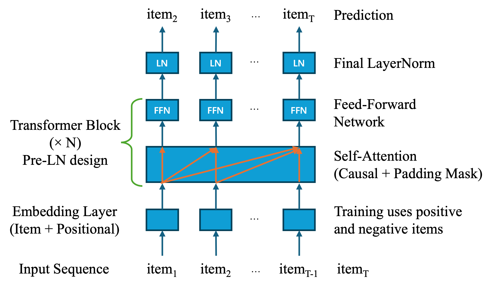

## Planning and Reflection for Agentic LLMs
`Agent Evaluation` | `Brittleness` | `Harnessing` | `BALROG` | `ReAct` | `Reflection`

- Built a reproducible BALROG evaluation pipeline for GPT-6.1-sol and Qwen3-4B-Instruct across BabyAI, TextWorld, and BabaIsAI, using seeded multi-episode experiments and automated performance reporting.
- Designed a ReAct-inspired language agent with dynamic planning, structured action generation, short-term memory, and explicit detection of repeated actions and state loops.
- Implemented and evaluated a Reflexion-style agent that converts trial outcomes into verbal memory, comparing matched with/without-reflection conditions using trial-level progression.

```{=html}
<div class="img-container" style="display: flex; gap: 2px; align-items: flex-start;">
  
  
</div>
```


## End-to-End Small LLM Development with Nanochat
`LLM Training Pipeline` | `Instruction Fine-tuning` | `Model Evaluation` | `Nanochat` | `Tokenization`

- Trained and compared 8K and 32K BPE tokenizers on 500MB of CLIMBMix data, then pre-trained a 13M-parameter Transformer while monitoring convergence through training and validation BPB.
- Designed a two-stage post-training pipeline using MMLU and GSM8K for capability-focused mid-training, followed by supervised fine-tuning on SmolTalk with assistant-only loss masking.
- Evaluated model checkpoints on ARC-Easy, ARC-Challenge, and GSM8K, analyzed domain shift and catastrophic forgetting, and tested temperature sampling and KV caching through a web inference interface.

```{=html}
<div class="img-container" style="display: flex; gap: 2px; align-items: flex-start;">
  
  
</div>
```


## Recommendation Challenge for Amazon Products
`Recommendation System` | `Sequential User Behavior` | `SASRec` | `BERT4Rec` | `LightGCN`

- Built a Top-10 Amazon product recommender for a Kaggle competition, evaluated by Recall@10.
- Compared SASRec, BERT4Rec, SASRec+, and LightGCN on temporally ordered user sequences.
- Designed a multi-stage pipeline with metadata-based candidate filtering and SASRec ranking.
- Ranked 8th/60 on the Kaggle leaderboard with the final SASRec-based recommendation system.

<p><a href="https://www.kaggle.com/competitions/recommender-system-challenge-2526-s-2/leaderboard">Kaggle Group 58</a>
```{=html}
<div class="img-container" style="display: flex; justify-content: flex-start; gap: 10px; align-items: flex-start;">
  
</div>
```


## SASS Robot Cat
`Robotics` | `Computer Vision` | `Speech Recognition` | `Actuator Control` | `Human-Robot Interaction`

- Built a ROS 2 robotic cat integrating vision, speech, navigation, and actuator control.
- Implemented person following, object search, autonomous docking, and state-based behaviors.
- Added expressive head, ear, and sound responses for interactive human-robot interaction.

<p><a href="https://www.youtube.com/watch?v=wJvU7m090wQ">Video</a> | <a href="https://github.com/ssswzh/SASS_cat">Code</a> </p>

```{=html}
<div class="img-container" style="display: flex; gap: 2px; align-items: flex-start;">
  
  
  
</div>
```


## Reinforcement Learning Algorithms for CartPole Problem
`Reinforcement Learning` | `Deep Q-Network` | `Actor Critic` | `A2C` | `Proximal Policy Optimization`

- Implemented Naive DQN, REINFORCE, AC, A2C, and PPO in CartPole environment. 
- Several engineering tricks were applied to improve performance and stability, including mini-batch update, multiple epochs, generalized advantage estimation (GAE), advantage normalization and entropy regularizatio, which are important for stable policy learning.
- The transition from value-based to policy-based to advanced policy-based methods suggests the evolution of reinforcement learning methods on providing greater flexibility and more expressive decision-making strategies.

```{=html}
<div class="img-container" style="display: flex; justify-content: flex-start; gap: 10px; align-items: flex-start;">
  
</div>
```


## Evolutionary Algorithm on Black-box Problems
`Genetic Algorithm` | `Evolutionary Strategy` | `Optimization` | `Black-box Problems`

- Implemented Genetic Algorithm (GA) and self-adaptive $(\mu,\lambda)$ Evolution Strategy (ES) from scratch for discrete and continuous optimization.
- Applied GA to [LABS and N-Queens](https://iohprofiler.github.io/IOHexp/) [@IOHprofiler;@IOHanalyzer;@IOHexperimenter], and ES with log-normal step-size adaptation to the Katsuura problem.
- Designed a budget-aware, step-wise hyperparameter tuning strategy to efficiently identify promising configurations.
- Evaluated convergence and robustness using EAF, ECDF, and Expected Runtime (ERT) across multiple runs.

